# AI Research Pipeline

An AI-assisted research workflow that turns a question into a cited report. It discovers sources, scrapes them with SSRF protections, summarizes the content, extracts and verifies claims, and exports the result as Markdown, PDF, or DOCX.

The backend is FastAPI + PostgreSQL/pgvector + Redis + Celery. The frontend is a React/Vite dashboard with live job progress, source and claim views, report download, and an admin console.

> This is a portfolio project, not a production-hardened research service. The [Known limitations](#known-limitations) section lists what is intentionally incomplete.

## How it works

```mermaid
flowchart LR
    U[User] --> W[React dashboard]
    W -->|JWT| A[FastAPI API]
    A -->|create job| Q[(Redis / Celery)]
    Q --> P[Research worker]
    P --> D[Source discovery<br/>Tavily / SerpAPI / DuckDuckGo / arXiv]
    D --> S[SSRF-safe scraping<br/>robots.txt + redirect checks]
    S --> C[Content cleaning and SHA-256 dedupe]
    C --> M[LLM summarization]
    M --> F[Claim extraction and quote verification]
    F --> R[Markdown / PDF / DOCX report]
    R --> DB[(PostgreSQL + pgvector)]
    A --> DB
    W -->|SSE progress + REST| A
```



The Celery worker runs the stages in order. Progress is exposed over Server-Sent Events (SSE), with a short-lived stream token available for browser `EventSource` clients that cannot send an `Authorization` header.

## What is implemented

- **Authentication and authorization**: JWT access/refresh tokens, PBKDF2 password hashing with bcrypt verification support, admin/researcher/viewer roles, per-user job ownership checks, and logout invalidation.
- **Research jobs**: per-user idempotency keys, Celery queueing, cancel requests, resume/restart, and stage/progress tracking.
- **Source discovery**: Tavily, SerpAPI, DuckDuckGo HTML fallback, and arXiv. API keys are optional; providers without keys are skipped.
- **Scraping safeguards**: HTTP/HTTPS validation, private/reserved IP blocking, DNS resolution checks, redirect re-validation, robots.txt checks, response-size limits, and Playwright request interception.
- **Prompt-injection defense**: scraped content is delimited and instruction-like patterns are removed before it reaches an LLM.
- **Summarization**: chunked/map-reduce summaries with a deterministic mock client for tests.
- **Claim verification**: claims are stored with source URL, quote, confidence, verdict, and reason; quotes must be present in the scraped source or the claim is marked unverified.
- **Reporting**: Markdown generation plus PDF/DOCX export with graceful fallbacks. Reports, claims, and sources are downloadable through ownership-checked endpoints.
- **Frontend**: sign-in/sign-up, dashboard, new-job form, live workspace, report/claims/sources tabs, admin provider and usage views, dark theme, responsive layout.
- **Operations**: Dockerfiles for backend and frontend, Docker Compose for a local demo stack, startup scripts, and Kubernetes starter manifests.

## Project layout

```text
backend/
  app/
    api/v1/            FastAPI routers, schemas, auth dependencies
    core/              settings, security, LLM client, logging
    ingestion/         search providers, scraper, parsers
    models/            SQLAlchemy models
    repositories/      database access
    services/          ingestion, summarization, fact-check, reporting
    workers/           Celery app and research task
    reporting/         Markdown/PDF/DOCX generators
  alembic/             schema migrations
  tests/               unit and integration tests
frontend/
  src/                 React app, API client, pages, contexts
  nginx.conf           production-style static server + /api proxy
infra/
  docker-compose.yml   local Postgres + Redis + API + worker + frontend
  k8s/                 starter manifests
scripts/
  dev.sh               one-command local dev stack
  verify.sh            backend tests + frontend build/typecheck
  logs.sh              tail local dev logs
```

## Quick start with Docker Compose

Requirements: Docker with Compose v2.

```bash
cd infra
cp .env.example .env
# Edit .env: set SECRET_KEY, POSTGRES_PASSWORD, REDIS_PASSWORD, and optional LLM keys.
docker compose up --build
```

- Frontend: <http://localhost:3000>
- API docs: <http://localhost:8000/docs>
- Health: <http://localhost:8000/api/v1/health>

Compose runs PostgreSQL with pgvector, Redis, the API, a Celery worker, and an nginx-served frontend. The database and Redis are only exposed on the internal Compose network.

For a real LLM run, set at least one provider key (`OPENAI_API_KEY`, `ANTHROPIC_API_KEY`, `GEMINI_API_KEY`, `GROQ_API_KEY`, or `OPENROUTER_API_KEY`). Without one, the API starts but job execution will fail at the LLM stage. Set `USE_MOCK_LLM=1` for a deterministic mock run.

## Local development

Requirements: Python 3.12, Node.js 20+, Docker (for the local Postgres container), and Redis.

```bash
# 1. Backend dependencies
cd backend
python3.12 -m venv .venv
.venv/bin/pip install -r requirements.txt
cp .env.example .env

# 2. Frontend dependencies
cd ../frontend
npm install

# 3. Start Postgres, Redis, migrations, API, worker, and frontend
cd ..
./scripts/dev.sh start
```

`scripts/dev.sh` creates a local `pgvector/pgvector:pg16` container on port **5434**, starts Redis, applies Alembic migrations, then runs uvicorn, a Celery worker, and Vite. Logs go to `logs/`. Use `./scripts/dev.sh status`, `./scripts/dev.sh stop`, or `./scripts/logs.sh`.

To run the processes in separate terminals instead:

```bash
# Terminal 1 - backend (after starting Postgres/Redis and running migrations)
cd backend
.venv/bin/python -m alembic upgrade head
cd ..
./start.sh backend

# Terminal 2 - frontend
./start.sh frontend
```

The frontend dev server runs at <http://localhost:3000> and defaults to `http://localhost:8000` for the API.

## Configuration

Backend settings use environment variables or `backend/.env`. Start with [`backend/.env.example`](backend/.env.example).

| Variable | Purpose |
|---|---|
| `DATABASE_URL` | Async PostgreSQL URL. The included dev stack uses port `5434`. |
| `REDIS_URL` | Redis database for general use. |
| `CELERY_BROKER_URL` / `CELERY_RESULT_BACKEND` | Celery broker and result backend. |
| `SECRET_KEY` | JWT signing key; at least 32 characters. Production rejects known placeholder prefixes. |
| `ENVIRONMENT` | `development` enables demo seeding; `production` disables it. |
| `OPENAI_API_KEY`, `ANTHROPIC_API_KEY`, `GEMINI_API_KEY`, etc. | LLM providers used by LiteLLM. |
| `TAVILY_API_KEY`, `SERPAPI_API_KEY` | Optional search providers. DuckDuckGo and arXiv work without keys. |
| `DEFAULT_LLM_MODEL` | Primary model, default `gpt-4o-mini`. |
| `REPORT_OUTPUT_DIR` | Report output directory, default `/tmp/reports`. |
| `USE_MOCK_LLM=1` | Use deterministic mock LLM responses for local testing. |
| `DEMO_SEED_ENABLED` | Seed demo users and a sample completed job in non-production environments. |

Demo accounts are seeded automatically in development:

| Role | Email | Password |
|---|---|---|
| Admin | `admin@example.com` | `DemoAdmin123!` |
| Researcher | `demo@example.com` | `DemoResearch123!` |
| Viewer | `viewer@example.com` | `DemoViewer123!` |

These are local demo credentials only. Set `DEMO_SEED_ENABLED=false` or use `ENVIRONMENT=production` before exposing an instance.

## API overview

Full request/response details are in [API.md](API.md).

| Method | Path | Purpose |
|---|---|---|
| `POST` | `/api/v1/auth/signup` | Create a researcher account and return tokens. |
| `POST` | `/api/v1/auth/login` | Sign in and return tokens. |
| `POST` | `/api/v1/auth/refresh` | Rotate an access token using a refresh token. |
| `POST` | `/api/v1/auth/logout` | Invalidate tokens issued before logout. |
| `GET` | `/api/v1/auth/me` | Current user. |
| `POST` | `/api/v1/research/jobs` | Create a research job. Accepts `query`, optional `urls`, and `Idempotency-Key`. |
| `GET` | `/api/v1/research/jobs` | List the current user's jobs. |
| `GET` | `/api/v1/research/jobs/{id}` | Job status, stage, progress, and error. |
| `GET` | `/api/v1/research/jobs/{id}/progress` | SSE progress stream (Bearer header or `?token=` stream token). |
| `GET` | `/api/v1/research/jobs/{id}/stream-token` | Issue a 5-minute stream token. |
| `POST` | `/api/v1/research/jobs/{id}/cancel` | Request cancellation. |
| `POST` | `/api/v1/research/jobs/{id}/resume` | Restart a failed or cancelled job. |
| `GET` | `/api/v1/research/jobs/{id}/sources` | Scraped sources for a job. |
| `GET` | `/api/v1/research/jobs/{id}/claims` | Extracted claims and verdicts. |
| `GET` | `/api/v1/reports/{id}` | Report metadata and Markdown. |
| `GET` | `/api/v1/reports/{id}/download?format=pdf\|docx\|markdown` | Download a report. |
| `GET` | `/api/v1/admin/providers` | Provider configuration and key availability (admin). |
| `GET` | `/api/v1/admin/usage` | Usage/job counters (admin). |

Job responses include both `current_stage` and a convenience `stage` field.

## Testing

Backend tests use the existing virtual environment and mock LLM calls:

```bash
cd backend
USE_MOCK_LLM=1 PYTHONPATH=$(pwd) .venv/bin/python -m pytest -q tests/unit tests/integration
```

Full verification (backend tests, frontend production build, and TypeScript check):

```bash
./scripts/verify.sh
```

The frontend has a production build and TypeScript check, but no automated UI test suite yet.

## Security notes

- SSRF protection blocks localhost, private/reserved networks, link-local metadata addresses, and re-validates every redirect hop.
- Scraped text is treated as untrusted and wrapped with an explicit data-only instruction before LLM calls.
- JWT secrets and provider keys come from environment variables; `infra/k8s/secret.yaml` is gitignored. Use `secret.example.yaml` as the template.
- Authentication and ownership checks are applied to job, source, claim, and report endpoints.
- Rotate any keys that were ever present in a local `.env` file before publishing or sharing a deployment.

## Known limitations

- **Resume restarts, it does not checkpoint.** There is no persisted per-stage checkpoint yet, so a resumed job starts again from `pending`. The Alembic schema contains a `checkpoints` column for future use, but the worker does not write it.
- **Progress is polled.** SSE reads the database every two seconds. Redis pub/sub is not wired.
- **Deduplication is exact-hash based.** SHA-256 URL/content hashes are used. The pgvector embedding column and migration exist, but embeddings are not generated and vector similarity search is not implemented.
- **`llm_gateway.py` is experimental.** The Celery worker uses `LiteLLMClient` with model fallback. The provider gateway is not on the execution path.
- **LLM usage is not persisted by the pipeline.** The `llm_usage` table and admin statistics endpoint exist, but the worker does not yet write usage rows.
- **No rate limiting.** Requests are not throttled yet.
- **CrewAI files are a scaffold.** `backend/app/agents/` contains an early CrewAI orchestration sketch; the production execution path is the Celery service-stage pipeline.
- **PDF/DOCX fallbacks are text files.** If WeasyPrint or python-docx dependencies are unavailable, the generator writes a readable fallback rather than failing the job.
- **Compose is for local demos.** It uses development defaults unless overridden. The Kubernetes manifests are starter templates and expect external PostgreSQL/Redis endpoints.
- **The global `/api/v1/sources` route is a placeholder.** Use `/api/v1/research/jobs/{id}/sources`.

## Disclaimer

Reports are AI-assisted. Every claim should be checked against the cited source before use. The demo data included in development is illustrative and is not real research.
